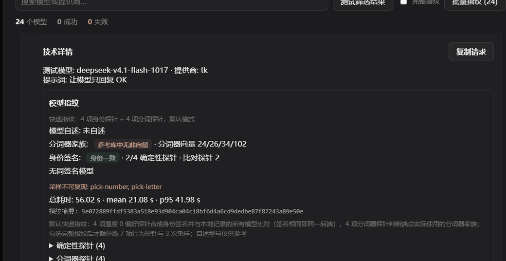

# 模型综合检测 · Model Probe

一个直接接入 DSH 当前模型路由的综合检测插件。侧栏底部提供「模型综合检测」入口，不单独保存 API 地址或密钥。





## 下载安装

- **[下载最新 ZIP 安装包](https://github.com/Vhow123/dsh-model-probe/releases/latest/download/dsh-model-probe.zip)**
- [查看 GitHub Releases 与历史版本](https://github.com/Vhow123/dsh-model-probe/releases)

下载并解压后，在 DSH 插件管理中将解压目录作为本地插件安装，并启用 `@local/dsh-model-probe`。也可以参考下方「安装与热加载」手动配置。

## 功能

- 从 DSH 实时读取所有提供商与模型目录。
- 单个提供商分组、模型搜索、单模型测试、勾选测试、筛选结果测试、全部测试。
- 批量测试可停止；连接检测支持 2 / 4 / 8 路并发与 15 / 45 / 90 秒超时选择。
- SVG 动画检测使用统一的「鹈鹕骑自行车」提示词，要求车轮转动、主体移动和循环动画，输出上限 16384 tokens，最长等待 5 分钟。
- 自定义 SVG 检测支持编辑最多 4000 字符的提示词；可只填写「三英战吕布」这样的简短主题，插件会自动补充完整 SVG、禁止 Markdown/解释文字等输出约束。可按提示词生成静态或动态 SVG，不强制包含动画。
- 自定义 SVG 默认启用「快速模式」，提示词和结果校验均限制在 3000 字节、30 个元素以内；关闭后恢复 12000 字节、100 个元素的普通模式。
- HTML 动画检测要求模型输出完整单文件 HTML（内联 `<style>` 与 CSS 动画允许保留），产物上限 64000 字节、输出上限 65536 tokens；清洗时只移除脚本、事件属性、外部链接与 `@import`，保留内联样式、`@keyframes`、`url(#id)` 和 `href="#id"`。默认摘要要求画面有循环动画，无动画记为 `STATIC_DRAWING`；自定义提示词则不强制动画。
- 每个模型都有独立的「◎ 指纹」按钮，分两种模式。**快速指纹（默认）**只跑 4 项温度 0 的偏好探针与 4 项分词器探针，输出分词器家族、身份签名、同签名模型和延迟统计；**完整指纹**（工具栏勾选）再额外跑身份、精确指令、推理、JSON、噪声、代码和中文共 7 项行为探针与 3 次随机数采样，补上行为分、样本完整度、分布签名与漂移判定。实测 `tk/deepseek-v4.1-flash` 由 303.5 s 降到 28 s。工具栏的「批量指纹」按顺序把当前筛选结果全部跑一遍——peers 只有多个模型都测过之后才有意义，而并发会让耗时报数失真。
- 为什么默认砍掉行为探针与随机数采样：两者对「这是不是真模型」零信息量。行为探针测的是可用性与服从性，`deepseek-v4.1-flash` 与 `gpt-6-astra` 都能拿 6/6；随机数采样在所有主流模型上都是均匀分布（熵 2.998 bit），区分不出任何两个模型。判断真伪只需要身份签名与分词器家族，这两项在快速模式下全部保留。四组探针并发执行（身份探针 3 路，分词器与行为探针、采样各 2 路），单个便宜模型不会同时打开二十个连接。单字符基线不是全程算一次，而是与正文计数成对读取——见下条。
- 分词器指纹：把四段固定的文本（英文pangram、中文段落、Python 片段、emoji 与生僻 Unicode）发给端点，读回它报告的 `inputTokens`，再减去同一个端点在紧邻一次调用里对单字符提示词的计数——那个差值就是分词器本身的计数，服务端隐藏的模板被减掉了。分词器来自厂商自己的词表文件，转发文本的中转站无法伪造，也不需要模型配合。参考值取自 [unclecode/modelprint](https://github.com/unclecode/modelprint)（MIT）截至 2026-11-13 的观测：23 个模型、350 个有计数的版本，剔除掉不可能是分词器计数的负值与越界值后，去重成 **55 条互异向量**。早期版本只留每模型的最新版本（21 行），丢掉了仍在服务的旧向量——`deepseek/deepseek-v4-pro` 一个模型 58 个版本里走过 27 种向量。参考值只能贴近「某个模型曾经的样子」，所以表里存的是向量而不是模型名，一个向量可以并列多个模型。
- 分词器指纹的基线必须成对读取：`a` 的计数只用来抵消服务端模板，它必须与正文计数来自同一个后端。全程只测一次基线更省调用，但在负载均衡路由上是错的——实测一条路由正文计数稳定返回 80，而基线先后返回 31 和 21 来自两个不同后端，把真实的 49 算成了假的 59，匹配结果从「deepseek」变成「参考库中无此向量」。现在每次正文计数都紧邻一次基线计数，且要求两组配对给出同一个差值才采信；一次调用落到别的后端只多花一次尝试，不会污染向量。
- 匹配失败时会给出最近邻：面板显示「最接近 47/68/60/91 · 1/4 维不同」。只差一维多半是某一项探针撞上了路由切换，重测即可；差两维以上说明词表与库里任何记录都无关，可能是尚未公开的词表或不同的服务端模板——**这不等于模型有问题**。
- 向量同时命中两个家族时不下结论：缺掉的那一维恰好是区分它们的唯一依据（实测 `tk/gpt-6-astra` 缺 `tok-chinese` 时，openai 的 `47/68/60/91` 与 glm 的 `47/56/60/91` 无法区分），此时返回「无法判断」并提示补测该维度。
- 「分词器计数不足」是另一种状态，与「参考库中无此向量」不同：四段探针里不足三段拿到可采信计数（通常是路由在多个后端之间轮换，同一段文本两次计数不同），此时连向量都不完整，无从比对。面板会说明原因，重测一次通常就能补齐。
- 分词器判定只在这两种情况下给出「与自述家族不符」：模型名能解析出家族（`gpt-` / `claude` / `deepseek` / `qwen` / `glm` / `kimi` / `gemini` / `grok` / `minimax` / `llama`）、且测出的向量只命中唯一一个家族。名字无法解析、或向量同时命中多个家族时，一律返回「无法判断」——`claudius-prime` 不会被当成 `claude`，宁可不说也不编。

- 身份签名：4 项偏好探针（`pick-number` / `pick-colour` / `pick-letter` / `pick-lang`）以 `temperature: 0` 解码，答案先经别名表归一（`蓝色` → `blue`、`navy blue` → `navy`、`golang` → `go`），再对「探针 id + 归一答案」做 SHA-256。同一后端连续跑会得到逐字节相同的签名，换后端则变——这是负载均衡路由下唯一可靠的身份信号来源。事实题（`Canberra`、`45`）不能用：答对的模型答案都一样，对区分模型零信息量；「选一种动物」「给三个数字」也不能用：实测同一路由每次给出不同结果。
- 抖动剔除：一次运行内重复 2 次仍不能复现自己答案的探针不会被写进签名，只在面板上以「采样不可复现」列出被剔除的 id。否则一条在 `A` / `Q` 之间摇摆的路由会让签名本身跟着抖动，健康的模型被误报成「身份已变化」，还会和同样摇摆的条目凑成假 peer。
- 漂移判定按探针逐项比对，不是比签名：一条路由这次少答了一题（超时、或该题被抖动剔除），签名就会和上次不同，但没有任何答案变过。所以基线存的是每个探针的归一答案，判定只看两轮共有的探针——全部相同判「身份一致」，没有共有探针才重建基线。新出现的探针会追加进基线，覆盖范围随运行次数变宽。
- 只有两项以上同时变才判「身份已变化」：真实换后端时整条向量一起变，而单项漂移是探针自己不稳。实测 `tk/deepseek-v4.1-flash-1017` 的 `pick-letter` 在运行内重复时一致、下一轮却从 `K` 变成 `Q`，其余三题从未动过——运行内复现检查抓不到它，旧逻辑却把它报成「身份已变化 · pick-letter」。现在单项漂移的答案会记进基线的 `volatile` 列表、该探针从此不参与身份判定与 peer 比对，面板改在「答案会在运行之间变动」一行列出，不再重复报警。
- 跨模型比对：每次指纹都会把本次答出的偏好题与本地记录过的**所有**模型逐项比对，共有探针全部相同即在详情里列出「同签名模型」并标红——这是新装环境（还没有自身历史）唯一能回答「这两行是不是同一个后端」的手段。基线按 `provider` + `model` 分开存，`~/.dsh/dsh-model-probe/fingerprint-baseline.json` 最多保留 200 条。答案格式与归一规则版本化（`probeSet`，当前 `IDENTITY_VERSION = 2`），插件升级换题时只重建基线，不误报漂移。注意「无同签名模型」只说明**本机**没有别的条目答出同样四个答案，不是对模型可信度的判断：偏好题里 `42` 与 `Python` 都是高频答案，所以恰好三项相同才算同一后端，不足三项一律不算。
- 分布签名：3 次采样各取 200 个 1–100 的整数，做 8 桶直方图并用 Jensen-Shannon 散度与同模型历史基线比较。阈值不用固定常数，而是对本次直方图 bootstrap 重采样 200 次取 p95 得到噪声底，阈值取噪声底的 3 倍——固定阈值在 200 样本下要么永远触发、要么永远失灵（公开报告里的 0.35 阈值比「两个完全不同的分布」还高一倍多）。
- 实测口径：主流模型的随机数采样是均匀的（熵 ≈ 2.998 bit、100 个数字各出现 7 次左右），所以分布签名区分不出不同模型，只反映「采样配置是否变了」；区分模型靠身份签名。空采样、被上游缓存命中的采样会被剔除，并在面板上给出提示。
- 指纹检测参考多探针行为分析思路；模型自述仅作参照。没有本地参考指纹库时不生成虚构的 Top-5 型号概率。
- 每个模型都有独立的「IQ」按钮：串行执行 18 道本地加权基准题（逻辑 4、算术 4、难题 3、代码 2、指令遵循 3、常识 1、陷阱 2），金丝雀题失败即判为异常；输出 0–100 智力值、旗舰/中端/轻量档位、加权得分、逐题证据和思考 Token。报告字段沿用公开检测报告的常见形态（tier / score / weighted_got / weighted_max / canary / percentile / peer_median），但不含私有题库，也不生成虚构的同模型排名。
- 智力检测可随时停止；总超时默认 10 分钟、单题 45 秒，失败题目标记为跳过，分数只按已完成题目计算。
- 提供商不返回 `reasoningTokens` 时，报告改为显示思考内容的字符数（`reasoning_chars`），不把有思考但未计量写成 0。
- SVG 结果支持动画预览、动画数量、清洗后的源码查看和请求详情；保留原生 SMIL 动画，脚本、外部资源和事件会被移除，清洗后最大 32 KiB。
- HTML 结果预览直接使用清洗后的整份文档（无权限 iframe，脚本不执行），预览高度 34vh（最小 220px），下方四项度量与公开报告一致：`Animated`（有循环动画为是、无则为否）、`Colors`（去重后的配色数）、`Overflow`（图形超出画布的百分比，按 `<g>`/元素 `transform` 组合后的坐标计算，超过 2% 用琥珀色提示「超出部分会被裁切」）、`External`（清洗后恒为无）。再下面是 SMIL 动画数、`@keyframes` 数、元素数与产物大小。`Overflow` 只统计真正会被裁掉的图形：按 `<g>` 与元素自身 `transform` 组合后的坐标求包围盒，完全落在画布外的形状忽略（看不见就谈不上裁切），铺满画布的底色/地面带/贯穿两侧的路面虚线忽略，只擦到边缘、可见部分仍超过 75% 的形状（光晕、软阴影）忽略，面积不到画布千分之五的碎屑忽略，`<defs>`/`<symbol>` 等模板与 `<animateTransform>` 驱动的位置也不参与（模板在原点绘制、由 `<use>` 摆位，动画组没有静态位置），其余超出部分按百分比计。预览时根 `<svg>` 的 `preserveAspectRatio` 会归一为 `xMidYMid meet`，避免模型选了 `slice` 导致主体被预览框裁掉。
- 流式测试、首个输出耗时、总耗时、回复与思考内容、Token 用量。
- 失败 code、HTTP 状态和脱敏错误信息。
- 可展开、可复制的技术请求详情。
- 密钥只由 Host 的凭据系统解析，浏览器页面接触不到密钥。

## 使用

1. 在左侧栏底部点击「模型综合检测」。
2. 在「测试类型」中选择「连接检测」「SVG 动画检测」「自定义 SVG 检测」或「HTML 动画检测」，再选择「测试全部」或勾选部分模型后点击「测试已选」；模型行的 `▶` 可单独测试。自定义模式会显示提示词编辑框，填写希望模型生成的 SVG 内容、风格和动画要求，并可开关默认启用的「快速模式」；HTML 模式同样可填提示词，留空则使用内置的鹈鹕自行车动画摘要（切到 HTML 模式时会清空自定义模式预填的示例提示词，避免覆盖内置摘要）。HTML 模式的超时可选 180/300/600 秒。
3. 批量测试时点击「停止」可中止当前任务。
4. 点击模型行末尾的 `⌄` 查看详细返回和请求；点击 `◎` 单独检测模型指纹，点击 `IQ` 运行智力基准，检测中点击 `■` 可停止。两个按钮互斥，同一模型不会同时跑指纹和智力题。
5. 修改提供商或模型配置后，点击面板右上角刷新按钮。

测试提示词为 `Reply with OK only.`。连接测试以模型请求正常完成为成功依据，不强制要求回复恰好是 `OK`；思考模型只返回思考内容也属于已连通。

SVG 检测提示词为 `Generate an animated SVG of a pelican riding a bicycle. Reply with SVG code only.`，并要求使用原生 SMIL 让车轮和主体形成 2–6 秒循环动画。只有回复包含完整、可清洗且至少含一个原生动画元素的 SVG 才算通过；静态 SVG 会标记为 `STATIC_SVG`。预览在禁用脚本与外部资源的无权限 iframe 中播放。

HTML 检测提示词要求输出完整单文件 HTML，允许内联 `<style>`、CSS 动画与 SMIL。模型若把输出配额全用在思考上而没有产出文档，会标记为 `OUTPUT_TRUNCATED`；产物无 SVG 记 `INVALID_ARTIFACT`，残留外部引用记 `EXTERNAL_RESOURCE`，超过 64000 字节记 `ARTIFACT_LIMIT_EXCEEDED`。

## 验证

```sh
node --check index.js
node --check client.js
node --check intelligence.js
node --test test/*.test.js
```

界面验收需要先起预览服务，再用带 `--remote-debugging-port=9223` 的浏览器打开预览页：

```sh
node test/ui-preview-server.mjs          # 127.0.0.1:8765 → 上游 127.0.0.1:50206
node test/ui-intelligence-check.mjs      # CDP 驱动，截图写入 test/intelligence-ui-result.png
```

`DMP_UPSTREAM_PORT` / `DMP_UPSTREAM_HOST` / `DMP_LISTEN_PORT` 可覆盖预览服务的上游与监听地址。`test/sync-locale.mjs` 把 `client.js` 内联字典里缺失的文案键补回 `locale/*.json`（`--dry-run` 只统计不写盘）。

Host 路由：

- `POST /api/dsh-model-probe/catalog`
- `POST /api/dsh-model-probe/test`
- `POST /api/dsh-model-probe/fingerprint`
- `POST /api/dsh-model-probe/intelligence`
- `POST /api/dsh-model-probe/stop`

## 安装与热加载

本机 `desktop` profile 已把本目录以 `link:F:/杂项/dsh-model-probe` 安装为 `@local/dsh-model-probe`，并在 `cordis.patch.yml` 的 `hmr.root` 中加入 `F:/杂项/dsh-model-probe`。修改文件后，更新该 profile 的 `cordis.patch.yml` 时间戳即可触发 Cordis reconcile；客户端模块由 Web HMR 更新。

在其他 profile 安装时，把本目录作为本地 link bundle 加入该 profile，并在 `dsh.profile.bundles` 中启用 `@local/dsh-model-probe`。
只接受 loopback、Host 匹配、Origin 同源的 POST 请求。请求体最大 32 KiB。
