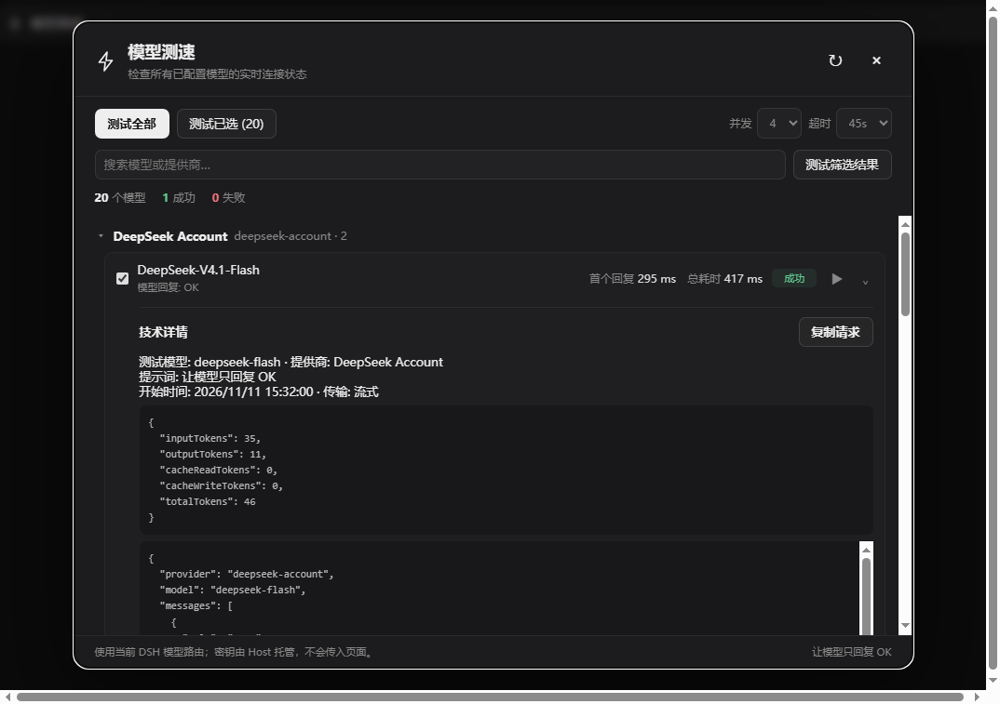
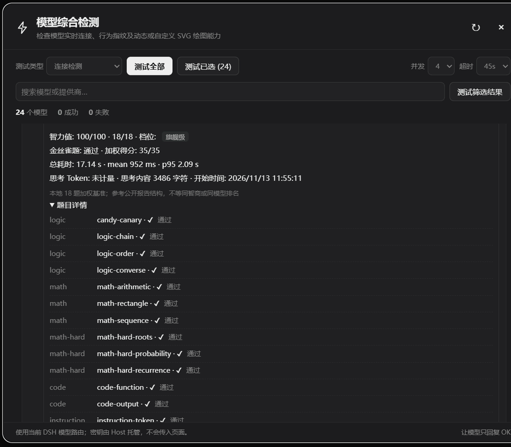
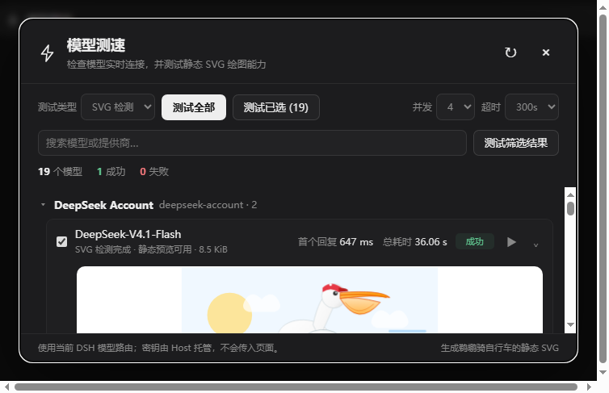

# 模型综合检测 · Model Probe

一个直接接入 DSH 当前模型路由的综合检测插件。侧栏底部提供「模型综合检测」入口，不单独保存 API 地址或密钥。







## 下载安装

- **[下载最新 ZIP 安装包](https://github.com/Vhow123/dsh-model-probe/releases/latest/download/dsh-model-probe.zip)**
- [查看 GitHub Releases 与历史版本](https://github.com/Vhow123/dsh-model-probe/releases)

下载并解压后，在 DSH 插件管理中将解压目录作为本地插件安装，并启用 `@local/dsh-model-probe`。也可以参考下方「安装与热加载」手动配置。

## 功能

- 从 DSH 实时读取所有提供商与模型目录。
- 单个提供商分组、模型搜索、单模型测试、勾选测试、筛选结果测试、全部测试。
- 批量测试可停止；连接检测支持 2 / 4 / 8 路并发与 15 / 45 / 90 秒超时选择。
- SVG 动画检测使用统一的「鹈鹕骑自行车」提示词，要求车轮转动、主体移动和循环动画，输出上限 16384 tokens，最长等待 5 分钟。
- 自定义 SVG 检测支持编辑最多 4000 字符的提示词；可只填写「三英战吕布」这样的简短主题，插件会自动补充完整 SVG、禁止 Markdown/解释文字等输出约束。可按提示词生成静态或动态 SVG，不强制包含动画。
- 自定义 SVG 默认启用「快速模式」，提示词和结果校验均限制在 3000 字节、30 个元素以内；关闭后恢复 12000 字节、100 个元素的普通模式。
- 每个模型都有独立的「◎ 指纹」按钮：串行执行身份、精确指令、推理、JSON、噪声、代码和中文共 7 项行为探针，输出行为分、样本完整度、延迟统计、探针证据和 SHA-256 行为摘要。
- 指纹检测参考多探针行为分析思路；模型自述仅作参照。没有本地参考指纹库时不生成虚构的 Top-5 型号概率。
- 每个模型都有独立的「IQ」按钮：串行执行 18 道本地加权基准题（逻辑 4、算术 4、难题 3、代码 2、指令遵循 3、常识 1、陷阱 2），金丝雀题失败即判为异常；输出 0–100 智力值、旗舰/中端/轻量档位、加权得分、逐题证据和思考 Token。报告字段沿用公开检测报告的常见形态（tier / score / weighted_got / weighted_max / canary / percentile / peer_median），但不含私有题库，也不生成虚构的同模型排名。
- 智力检测可随时停止；总超时默认 10 分钟、单题 45 秒，失败题目标记为跳过，分数只按已完成题目计算。
- 提供商不返回 `reasoningTokens` 时，报告改为显示思考内容的字符数（`reasoning_chars`），不把有思考但未计量写成 0。
- SVG 结果支持动画预览、动画数量、清洗后的源码查看和请求详情；保留原生 SMIL 动画，脚本、外部资源和事件会被移除，清洗后最大 32 KiB。
- 流式测试、首个输出耗时、总耗时、回复与思考内容、Token 用量。
- 失败 code、HTTP 状态和脱敏错误信息。
- 可展开、可复制的技术请求详情。
- 密钥只由 Host 的凭据系统解析，浏览器页面接触不到密钥。

## 使用

1. 在左侧栏底部点击「模型综合检测」。
2. 在「测试类型」中选择「连接检测」「SVG 动画检测」或「自定义 SVG 检测」，再选择「测试全部」或勾选部分模型后点击「测试已选」；模型行的 `▶` 可单独测试。自定义模式会显示提示词编辑框，填写希望模型生成的 SVG 内容、风格和动画要求，并可开关默认启用的「快速模式」。
3. 批量测试时点击「停止」可中止当前任务。
4. 点击模型行末尾的 `⌄` 查看详细返回和请求；点击 `◎` 单独检测模型指纹，点击 `IQ` 运行智力基准，检测中点击 `■` 可停止。两个按钮互斥，同一模型不会同时跑指纹和智力题。
5. 修改提供商或模型配置后，点击面板右上角刷新按钮。

测试提示词为 `Reply with OK only.`。连接测试以模型请求正常完成为成功依据，不强制要求回复恰好是 `OK`；思考模型只返回思考内容也属于已连通。

SVG 检测提示词为 `Generate an animated SVG of a pelican riding a bicycle. Reply with SVG code only.`，并要求使用原生 SMIL 让车轮和主体形成 2–6 秒循环动画。只有回复包含完整、可清洗且至少含一个原生动画元素的 SVG 才算通过；静态 SVG 会标记为 `STATIC_SVG`。预览在禁用脚本与外部资源的无权限 iframe 中播放。

## 验证

```sh
node --check index.js
node --check client.js
node --check intelligence.js
node --test test/*.test.js
```

界面验收需要先起预览服务，再用带 `--remote-debugging-port=9223` 的浏览器打开预览页：

```sh
node test/ui-preview-server.mjs          # 127.0.0.1:8765 → 上游 127.0.0.1:50206
node test/ui-intelligence-check.mjs      # CDP 驱动，截图写入 test/intelligence-ui-result.png
```

`DMP_UPSTREAM_PORT` / `DMP_UPSTREAM_HOST` / `DMP_LISTEN_PORT` 可覆盖预览服务的上游与监听地址。`test/sync-locale.mjs` 把 `client.js` 内联字典里缺失的文案键补回 `locale/*.json`（`--dry-run` 只统计不写盘）。

Host 路由：

- `POST /api/dsh-model-probe/catalog`
- `POST /api/dsh-model-probe/test`
- `POST /api/dsh-model-probe/fingerprint`
- `POST /api/dsh-model-probe/intelligence`
- `POST /api/dsh-model-probe/stop`

## 安装与热加载

本机 `desktop` profile 已把本目录以 `link:F:/杂项/dsh-model-probe` 安装为 `@local/dsh-model-probe`，并在 `cordis.patch.yml` 的 `hmr.root` 中加入 `F:/杂项/dsh-model-probe`。修改文件后，更新该 profile 的 `cordis.patch.yml` 时间戳即可触发 Cordis reconcile；客户端模块由 Web HMR 更新。

在其他 profile 安装时，把本目录作为本地 link bundle 加入该 profile，并在 `dsh.profile.bundles` 中启用 `@local/dsh-model-probe`。
只接受 loopback、Host 匹配、Origin 同源的 POST 请求。请求体最大 32 KiB。
